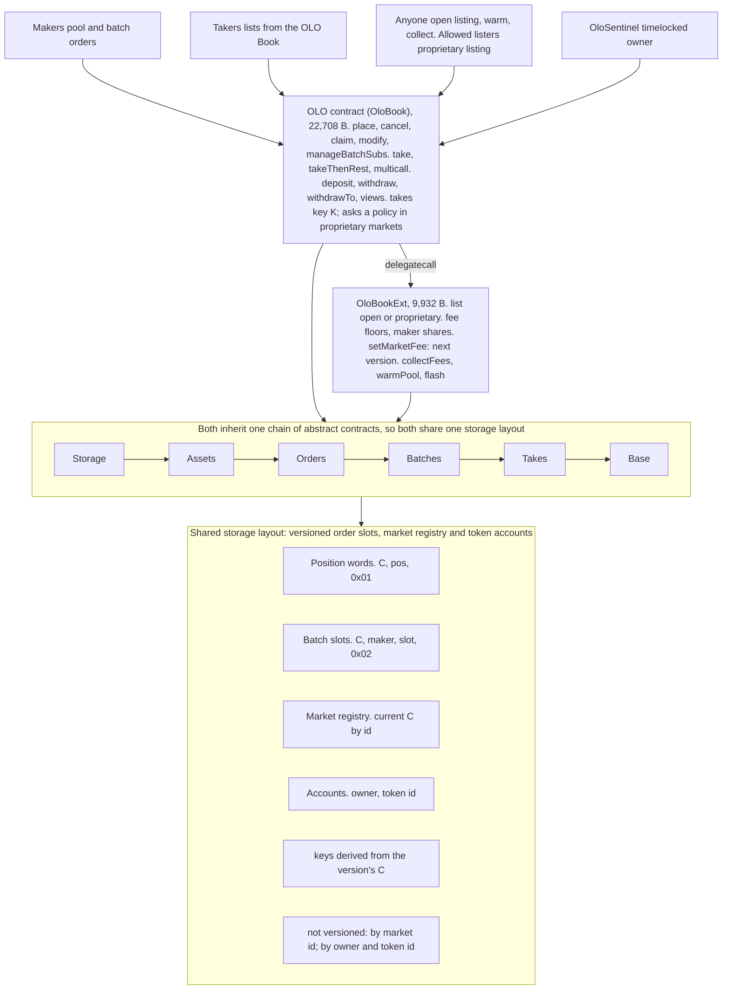

Context Doc

# OLO Contracts — Audit Context

Audit context for OLO at `limitorder-org/v1-core`, `main` @ <span style="color:#015b45">`0f7ab6a`</span>. Scope: OLO (contracts `OloBook` and `OloBookExt`) and its owner contract `OloSentinel`, that is every file under `src/` and `sentinel/`.


**Terms note:** OLO (open limit order) is the trading primitive and its on-chain backbone contract: `OloBook`, with its delegatecall extension `OloBookExt`, in code. OLO Book is the order books reconstructed from OLO's events. Names in code font are the repo's identifiers and are kept as they are.

## 0. Scope & repository snapshot


The scope is all of `src/` plus `sentinel/` in `v1-core` (<span style="color:#015b45">(26</span> files, <span style="color:#015b45">2,700</span> nSLOC). Everything else in the repository (`test/`, `docs/`, `lib/forge-std`) is out of scope.

<table>
<thead>
<tr>
<th>Field</th>
<th>Value</th>
</tr>
</thead>
<tbody>
<tr>
<td>Repository</td>
<td>limitorder-org/v1-core Licence: Business Source License 1.1 for everything except src/interfaces/, which is MIT (LICENSE-MIT) so integrations may import it in production. BUSL Licensed Work “Open Limit Order v1 Core”; Change Date 2030-11-12, then GPL-2.0-or-later; no Additional Use Grant. “Patent pending” (NOTICE and src’s implementation files)</td>
</tr>
<tr>
<td>Commit to audit</td>
<td>main @ 0f7ab6a141ac82f768702cfd9da0c72e61db6403 (2026-11-16 00:36 UTC+8), the commit under audit</td>
</tr>
<tr>
<td>Language / compiler</td>
<td>Solidity 0.8.38 (foundry.toml; pinned pragma in every in-scope file except the nine MIT files in src/interfaces/, which declare ^0.8.8 so integrations can import them), via-IR, optimizer on, EVM cancun (needs EIP-1153 transient storage)</td>
</tr>
<tr>
<td>Optimizer runs</td>
<td>OloBook and OloBookExt ship at 20,000 runs (hirun profile, built from src only). OloSentinel builds at 120 runs in its own sentinel profile, apart from src: placed inside src it changed OLO’s via-IR output to 25,140 B, over EIP-170</td>
</tr>
<tr>
<td>Runtime sizes</td>
<td>OloBook 22,708 B (1,868 B under EIP-170), OloBookExt 9,932 B, OloSentinel 4,421 B (the hirun and sentinel builds)</td>
</tr>
<tr>
<td>Toolchain</td>
<td>Foundry 1.x (the team uses 1.8.5), forge-std v1.17.0 (a submodule, pinned in foundry.lock)</td>
</tr>
<tr>
<td>Source visibility</td>
<td>BUSL-1.1 source in v1-core (LICENSE, NOTICE), with src/interfaces/ under MIT (LICENSE-MIT). A public audit with no NDA, and the deployed contracts will be verified on explorers at the production deploy</td>
</tr>
</tbody>
</table>

Page 1 of 42

---

Context Doc

<table>
<thead>
<tr><th>Field</th><th>Value</th></tr>
</thead>
<tbody>
<tr><td>Audit type /<br />timeline</td><td>A public contest starting 2026-11-16, 9 days for submissions, 11k reward pool</td></tr>
</tbody>
</table>


## In scope

<table>
<thead>
<tr><th>File</th><th>nSLOC</th><th>What it is</th></tr>
</thead>
<tbody>
<tr><td>src/OloBook.sol</td><td>433</td><td>Core entry points: place, cancel,<br />claim, modify, take, takeThenRest,<br />multicall, deposit/withdraw, views<br />(marketIdGivenListingWord<br />among them), policy checks,<br />delegatecall forwarder</td></tr>
<tr><td>src/base/OloBookTakes.sol</td><td>402</td><td>Take walk over a segmented list,<br />exact quote sum, quote mode, fill-or-<br />kill</td></tr>
<tr><td>src/base/OloBookBatches.sol</td><td>249</td><td>Batch slots (up to four sub-orders,<br />bids, asks or both, a side bit each):<br />post, replace, modify, cancel, claim</td></tr>
<tr><td>src/OloBookExt.sol</td><td>228</td><td>Delegatecall extension: open and<br />proprietary listing, the lister allow-<br />list, fee floors, fee and share<br />versions, listing fee, fee collection,<br />pool warming, the flash credit<br />(flash)</td></tr>
<tr><td>src/base/OloBookOrders.sol</td><td>204</td><td>Pool-position orders: place, settle,<br />modify, probing</td></tr>
<tr><td>src/base/OloBookAssets.sol</td><td>201</td><td>Accounts, wallet/account<br />settlement, fee split, the multicall<br />ledger</td></tr>
<tr><td>sentinel/OloSentinel.sol</td><td>185</td><td>OLO’s owner: a timelock that<br />schedules each owner call a delay<br />ahead, one op per setting, with a<br />cancelling guardian</td></tr>
<tr><td>src/OloTypes.sol</td><td>173</td><td>Storage keys and word layouts<br />(position, account, batch slot with<br />its side bits, listing word)</td></tr>
</tbody>
</table>

Page 2 of 42

---

Context Doc

<table>
<thead>
<tr><th>File</th><th>nSLOC</th><th>What it is</th></tr>
</thead>
<tbody>
<tr><td>src/base/OloBookStorage.sol</td><td>111</td><td>Storage layout shared by the OLO<br />contract and its extension; market<br />registry; _current /<br />_checkCurrent; _admit (the policy<br />call)</td></tr>
<tr><td>src/types/Market.sol</td><td>93</td><td>Listing parameters, the fields of the<br />market word C = K | tag (key: tokens,<br />spacing, minQuote, proprietary bit,<br />id; tag: maker share, fee, version),<br />and MarketLib, which reads and<br />builds C</td></tr>
<tr><td>src/libraries/PriceGrid.sol</td><td>86</td><td>The 6-significant-figure price grid<br />and tick spacing</td></tr>
<tr><td>src/interfaces/IOloBookBase.sol</td><td>77</td><td>Errors, events, listing getters</td></tr>
<tr><td>src/interfaces/IOloBook.sol</td><td>45</td><td>NatSpec for every OLO entry point</td></tr>
<tr><td>sentinel/IOloSentinel.sol</td><td>41</td><td>Sentinel interface, events and errors</td></tr>
<tr><td>src/interfaces/OloListings.sol</td><td>35</td><td>A library for integrations: packs the<br />parameters a market was listed with<br />into its listing word and asks<br />marketIdGivenListingWord for the<br />id (marketIdOf, paramsOf)</td></tr>
<tr><td>src/interfaces/IOloBookExt.sol</td><td>32</td><td>Extension entries</td></tr>
<tr><td>src/libraries/OloMath.sol</td><td>29</td><td>Powers of ten, toUnits (units x<br />10^q)</td></tr>
<tr><td>src/libraries/SafeTransfer.sol</td><td>20</td><td>ERC-20 and native transfers</td></tr>
<tr><td>src/base/Owned2Step.sol</td><td>20</td><td>Two-step ownership</td></tr>
<tr><td>src/interfaces/IOwned2Step.sol</td><td>11</td><td>Ownership interface</td></tr>
<tr><td>src/libraries/Flags.sol</td><td>6</td><td>Settlement flags (WALLET, AUTO)</td></tr>
<tr><td>src/interfaces/IERC20Minimal.sol</td><td>6</td><td>Minimal ERC-20 interface</td></tr>
<tr><td>src/interfaces/IOloMarketPolicy.sol</td><td>4</td><td>The policy a proprietary market’s<br />lister supplies: admitted(marketId,<br />who, isMaker)</td></tr>
</tbody>
</table>

3 of 42

---

Context Doc

<table>
<thead>
<tr><th>File</th><th>nSLOC</th><th>What it is</th></tr>
</thead>
<tbody>
<tr><td>src/interfaces/IOloFlashCallback.sol</td><td>4</td><td>What a flash's caller answers:<br />oloFlashCallback(token, amount,<br />data)</td></tr>
<tr><td>src/base/OloBookBase.sol</td><td>3</td><td>Base the two deployables inherit</td></tr>
<tr><td>src/interfaces/MarketWord.sol</td><td>2</td><td>The MarketWord type (C), in its own<br />MIT file so the interfaces can name it</td></tr>
</tbody>
</table>


nSLOC here = non-blank, non-comment lines, counted from the files at <span style="color:#005b45">`0f7ab6a` (2,700</span> in total). The <span style="color:#005b45">nine</span> files in `src/interfaces/` are MIT; every other in-scope file is BUSL-1.1. A tool such as `cloc` or `solidity-code-metrics` may differ slightly.

## Out of scope

<table>
<thead>
<tr><th>Path</th><th>Why</th><th>Status</th></tr>
</thead>
<tbody>
<tr><td>Deploy script and its test (internal)</td><td>Deploys OLO, sets production<br />parameters and hands OLO to a new<br />OloSentinel as its last step. Kept<br />internal: not in v1-core</td><td>Out</td></tr>
<tr><td>test/** (with test/utils/**), docs/</td><td>Tests, reference models, mock and<br />hostile tokens; the assembly index and<br />the lint triage</td><td>Out</td></tr>
<tr><td>lib/forge-std</td><td>Third-party</td><td>Out</td></tr>
<tr><td>First-party router and aggregator<br />adapters</td><td>Planned to integrate OLO; not in this<br />repo</td><td>Out</td></tr>
<tr><td>OLO Book (non on chain) components<br />(indexer, front end, sentinel watcher,<br />SDK, subgraph)</td><td>Publicly buildable; first-party ones will<br />be open source</td><td>Out</td></tr>
</tbody>
</table>

## 1. Protocol Overview

### 1.1 Summary

OLO (open limit order) is an on-chain limit order primitive for EVM chains with Cancun opcodes. The OLO contract does three things only: it escrows an order when a maker places it, it fills the orders a taker names (in the order named, each at its own price), and it

Page 4 of 42

---

Context Doc

pays makers when they settle. It keeps no price levels, best price, bitmap or queue. The order books that takers take are reconstructed from OLO's on chain events, so there is no strict price-time priority on chain. An order that <span style="color:#025b44">was emptied, or now rests at a price worse than the bound its list entry carries,</span> is skipped at take, as the in-built taker protection design.

Value moves as follows. Users hold internal balances (one account per owner and token) through `deposit` / `withdraw`, or settle a single call from their wallet (WALLET / AUTO flags). Makers rest orders in shared **pool positions** (one storage word per order, 32-bit positions per market version) or in their own **batch slots** (up to four <span style="color:#025b44">orders, bids, asks or both,</span> in two words, 65,536 slots per maker per market version). A taker pays `ceil(quote) + ceil(fee)` for base, or receives `floor(quote) - ceil(fee)`. OLO holds the whole fee until the maker settles (claim, cancel, modify, or a batch operation), then splits it at the maker share of the version the order rests in: the maker gets that share, and the protocol pot (owner `address(0)`'s account) gets the rest. Anyone can call `collectFees(token)` to push a pot to the fee recipient. Listing a market is permissionless and can cost a native-currency listing fee. <span style="color:#025b44">A contract can also take a free **flash credit** (`flash`): OLO credits its account, calls it back, and debits the account again before the call ends.</span>

A market keeps one key K for life (tokens, spacing, minQuote, id); its fee and maker share live in a version tag, and each change is the market's next version. OLO's owner is `OloSentinel`, a timelock: every owner call is scheduled a delay (1 to 30 days) ahead, and a guardian can cancel it.

OLO also hosts **proprietary markets**, for regulated venues: a lister the owner allows lists a market with a policy contract that admits its makers and takers (for example after a KYB). They share OLO's accounts with the open markets, and the policy is never asked on an exit (cancel, claim, deposit, withdraw).

Model: a central limit order (CLOB) primitive. OLO leaves the order books themselves to the OLO Book and drops on-chain matching in favour of "takes by position": the taker names the exact orders to fill.

**Target users:** retail users, arbitrageurs, bot traders, market makers, asset issuers, aggregators, solvers, and all DeFi integrators who have on chain trading demands, including making and taking. **Production chains:** Ethereum mainnet, BSC, Arbitrum, Base, and compatible EVM chains (see 3.1).

## 1.2 Key Design Changes / Novel Mechanisms

OLO's key mechanisms:

Page 5 of 42

---

Context Doc

- **No price levels; the taker names the orders.** A take list is segments of pool entries (pos, tick) and batch groups (maker, slot, mask, a tick per sub-order). An entry is skipped when the order is empty, on the wrong side, or rests at a worse tick than the entry's bound. A better tick fills at the order's own tick.
- **Shared, reusable pool positions.** Positions are 32-bit, shared per market version, and rewritten in place. A place probes up to k further positions (flags bits 4-7) when its named one is live. Positions can be pre-warmed (`warmPool`) so the first order pays a 2.9k rewrite, not a 20k fresh write.
- **Maker-owned batch slots.** Up to four <span style="color:#005a44">sub-orders, bids, asks or both (a side bit each),</span> in a main word plus a settlement word, keyed by (version's C, maker, slot). A take writes only the main word (open units). The maker's next settle or claim of a sub-order pays its fills as `base -` <span style="color:#005a44">`open`, on that sub-order's side.</span> Base is then updated only where it is needed: a claim that leaves units open sets base to open, a rest sets it to the new order's units, and an emptied sub-order keeps its old base. So `base >= open` always. <span style="color:#005a44">A two-sided requote (two bids and two asks) is one call.</span>
- **One global price grid.** Tick t = d x 900,000 + j, P(t) = (100,000 + j) x 10^(d - 43) quote wei per base wei: 6 significant figures over 74 decades, ticks 1 .. 66,599,999. Makers rest at tick 3,600,000 or above and on the market's spacing (6, 5, 4 or 3 figures). Takers are not held to the spacing.
- **Amounts in base wei, stored as units x 10^q.** Units are below 2^30, q at most 25, exact below 2^30 wei. A take sums its fills' exact quote and rounds once (a buy up, a sell down); the fee is the exact sum's, rounded up.
- **Quote mode and fill-or-kill tolerance.** Mode bit 0x02 makes the amount quote wei; bit 0x80 reverts `FokNotFilled` when more than `maxLeft` (77 bits) is left.


- **Constant market key, versioned config.** A market word C = K | tag: the key K (tokens, spacing, minQuote, proprietary bit, id) is fixed at listing; the tag (maker share, fee, version; bits 174-223) changes. Every market entry takes K; those that fill, settle or rest an order again name a version by its tag in params bits 206-255 (a place and a batch post rest in the current version and name none; a multicall header gives K or a C). Storage keys derive from the version's C, so versions rest side by side. Takes and single-call settles read no registry word (a multicall under a K header reads it once per run, cancels and claims included); entries that rest an order read the current C from the registry `_markets[id]`.
- **Fee and share changes are new versions.** `setMarketFee` and `setMarketMakerShare` write the market's next version in place (same id and K; `MarketConfigSet`; at most 65,535 versions). An order always fills at its version's fee and settles at its version's share, so a change never reaches a resting order. Older versions fill, cancel and claim but rest nothing new (`MarketFrozen`).

Page 6 of 42

---

Context Doc

- **Fee floors and steps.** Fee floors (global, per pair) bind new listings. <span style="color:#025c45">Fees and floors range from 0 to 1,000,000 ppm (100%).</span> Every owner fee or floor call moves at most 10,000 ppm (1%).
- **Proprietary markets.** C's bit 170 marks a proprietary market; only a word carrying it reaches that market's orders, and an open twin of the same parameters is a separate market. Only owner-allowed listers list one (`listMarketQuoteProprietary`), naming a policy fixed for good. OLO asks the policy (`IOloMarketPolicy.admitted`, a static call) before an entry that makes or takes there, never on exits.
- **Timelocked owner.** `OloSentinel` owns OLO. Its admin schedules each owner call as an op a delay ahead (1-30 days, set at deployment and changed only by a setDelay op; 1 day in production) and runs it within 7 days of its eta. Each setting has one op pending at a time, so a market's fee and the global floor move at most 1% per delay. A guardian can cancel any op except a guardian change. It runs 13 kinds of op, the proprietary lister allow-list included.
- **OLO contract + delegatecall extension.** Cold entries (listing, admin, fee collection, <span style="color:#025c45">warming, flash</span>) run in `OloBookExt` by delegatecall on OLO's storage, to stay under EIP-170. A transient-storage lock guards every call that moves tokens.
- <span style="color:#025c45">**Flash credit.** `flash(token, amount, data)` credits the caller's account, calls `IOloFlashCallback.oloFlashCallback` on the caller (only on `msg.sender`) with the lock open, so the callback may call any entry (a nested flash included), then debits the account by the same amount: the flash reverts whole unless the account holds it again. Free (no fee). The credit is bounded by an account's 2^128 - 1, not by what OLO holds: a credit beyond OLO's holding of the token can be spent inside OLO but not withdrawn. Not a market entry, so no policy is asked; the entries the callback calls ask theirs.</span>
- **Packed calldata.** Each entry takes K plus its scalars in one packed `uint256 p`; `multicall` takes a custom byte stream; `manageBatchSubs` takes all four amounts in a static `uint256[2]`, two per word.

### 1.3 Actors

<table>
<thead>
<tr><th>Actor</th><th>Who</th><th>Goal</th></tr>
</thead>
<tbody>
<tr><td>Maker</td><td>Anyone resting single orders via<br />place, modify, cancel, claim,<br />multicall</td><td>Earn the spread and its<br />maker share of the fee</td></tr>
<tr><td>Maker (batch / market<br />maker)</td><td>Anyone using their own batch slots via<br />manageBatchSubs (often from a<br />contract wallet or EIP-7702 account)</td><td>Requote many orders<br />cheaply</td></tr>
</tbody>
</table>

Page 7 of 42

---

Context Doc

<table>
<thead>
<tr><th>Actor</th><th>Who</th><th>Goal</th></tr>
</thead>
<tbody>
<tr><td>Taker</td><td>EOA, contract, or router calling take / takeThenRest with a list built from the OLO Book (from on-chain events)</td><td>Fill at or better than each listed tick; optionally rest the remainder</td></tr>
<tr><td>Arbitrageur / bot trader</td><td>Automated traders taking, and often making, across OLO markets and other venues</td><td>Close price gaps; quote and fill at speed</td></tr>
<tr><td>Aggregator / solver</td><td>Routes user or intent flow into OLO takes (wallet settlement or its own pre-funded accounts, its own list and bounds)</td><td>Best execution for its users</td></tr>
<tr><td>Asset issuer</td><td>A token's issuer listing markets for its token (open, or proprietary if the owner allows it)</td><td>Liquidity and price discovery for its token</td></tr>
<tr><td>Depositor</td><td>Any account holder</td><td>Hold internal balances for cheaper gas in trading</td></tr>
<tr><td>Flash borrower</td><td>A contract implementing IOloFlashCallback (an EIP-7702 account counts)</td><td>Use OLO's token holding inside one call, free: arbitrage, deposit-repaid fills, refinancing</td></tr>
<tr><td>Lister</td><td>Anyone calling listMarketQuote (pays the listing fee)</td><td>Open a market for a token pair</td></tr>
<tr><td>Proprietary lister</td><td>An address the owner allows (setProprietaryListingAllowed), calling listMarketQuoteProprietary</td><td>Run a venue whose traders its policy admits (for example a KYB'd venue)</td></tr>
<tr><td>Market policy</td><td>A contract the proprietary lister supplies (IOloMarketPolicy), possibly behind its own proxy</td><td>Admit or refuse makers and takers in that one market</td></tr>
<tr><td>Warmer</td><td>Anyone calling warmPool</td><td>Pre-pay storage so later places are cheaper in gas</td></tr>
<tr><td>Fee collector</td><td>Anyone calling collectFees(token); funds always go to feeRecipient</td><td>Sweep the protocol pot</td></tr>
</tbody>
</table>

Page 8 of 42

---

Context Doc

<table>
<thead>
<tr><th>Actor</th><th>Who</th><th>Goal</th></tr>
</thead>
<tbody>
<tr><td>OLO owner</td><td>OloSentinel contract (see 4.1)</td><td>Apply fee, floor, share,<br />listing-fee, recipient,<br />lister and ownership<br />changes, each a delay<br />after it is announced</td></tr>
<tr><td>Sentinel admin</td><td>A multisig (Safe)</td><td>Schedule, execute and<br />cancel owner ops</td></tr>
<tr><td>Sentinel guardian</td><td>An EOA in production (the contract<br />accepts any address; zero means no<br />guardian)</td><td>Cancel a bad op before<br />it runs</td></tr>
<tr><td>Fee recipient</td><td>Address set by the owner</td><td>Receive protocol fees<br />and listing fees</td></tr>
<tr><td>OLO Book: indexer,<br />front end, sdk,<br />sentinel watcher</td><td>OLO Book components (see 4.3)</td><td>Reconstruct the order<br />books from OLO's<br />events, build take lists,<br />vet markets, watch<br />scheduled ops</td></tr>
</tbody>
</table>

## 1.4 Core User Flows

All flows are synchronous and single-transaction, except owner changes: those are scheduled on `OloSentinel` and executed at least a delay later.

<table>
<thead>
<tr><th>Flow</th><th>Entry point</th><th>Touches, in order</th></tr>
</thead>
<tbody>
<tr><td>Deposit / withdraw</td><td>OloBook.deposit / withdraw / withdrawTo</td><td>OloBookAssets._deposit / _withdraw →<br />_pull (balance-delta check) / _push →<br />token. Never asks a policy</td></tr>
<tr><td>Place pool order</td><td>OloBook.place(K, p)</td><td>_admit as maker if the market is<br />proprietary → MarketLib.makerTick →<br />_restAmount (toUnits, minQuote) →<br />_current (registry: K must be the market’s<br />key; rests in the current version) →<br />OloBookOrders._placeOp (probe) →<br />_debit account or _fund wallet; Placed;<br />order id = pos | tag &#x3C;&#x3C; 206</td></tr>
</tbody>
</table>

Page 9 of 42

---

Context Doc

<table>
<thead>
<tr><th>Flow</th><th>Entry point</th><th>Touches, in order</th></tr>
</thead>
<tbody>
<tr><td>Cancel / claim / modify</td><td>OloBook.cancel / claim / modify(K, p), the order's version tag in p</td><td>modify only: _admit as maker if proprietary, then _modifyEntry (_checkCurrent: MarketFrozen for an older version) → _cancelOp / _claimOp / _modifyOp → _splitFee (the version's share) → _settleFlows; Cancelled / Claimed / Modified</td></tr>
<tr><td>Batch maker operation</td><td>OloBook.manageBatchSubs(K, p, amountWords) (post, replace, modify, cancel, claim)</td><td>post / replace / modify: _admit as maker if proprietary → the slot's version: post _current, other kinds the version the params' tag names → OloBookBatches._manageBatch (one call; replace and modify _checkCurrent) → _slotWalk → _batchFlows → _splitFee → settle; BatchUpdated</td></tr>
<tr><td>Take</td><td>OloBook.take(K, list, p), the version's tag in p</td><td>_admit as taker if proprietary (once, before the list) → OloBookTakes._take → _fillSegments → _fillList (pool) / _fillBatches (batch) → _accrue / _affordable → _finishTake (round once, fee, fill-or-kill, settle); Take. A tag no version has finds no orders; fill-or-kill still applies</td></tr>
<tr><td>Take then rest</td><td>OloBook.takeThenRest(K, list, p)</td><td>_admit as taker if proprietary → fills in the tagged version → _restsAt → makerTick (when anything is left) → when it rests: _admit as maker if proprietary → _current → _placeOp in the current version → _finishTake (one settlement); returns restOrderId</td></tr>
<tr><td>Multicall</td><td>OloBook.multicall(settle, data)</td><td>header entries are a K (the current version for the run) or a C (that version) → PLACE / CANCEL / CLAIM / MODIFY / DEPOSIT / WITHDRAW against a memory ledger (≤ 4 accounts); a proprietary market's first PLACE or MODIFY in a run asks _admit as maker → _commit; Ops</td></tr>
<tr><td>List market</td><td>OloBook.listMarketQuote(...) (payable)</td><td>_delegate → OloBookExt._list → fee floor + pair defaults → _registerToken x2 → listing word (once) → registry (version 1) → _warmPool</td></tr>
</tbody>
</table>

Page 10 of 42

---

Context Doc

<table>
<thead>
<tr><th>Flow</th><th>Entry point</th><th>Touches, in order</th></tr>
</thead>
<tbody>
<tr><td>List<br />proprietary<br />market</td><td>OloBook.listMarketQuoteProprietary(...,<br />policy) (payable)</td><td>_delegate →<br />OloBookExt.listMarketQuoteProprietary:<br />allowed lister (NotProprietaryLister),<br />policy with code (BadPolicy) → _list<br />with bit 170 → policy stored for good;<br />ProprietaryMarketListed</td></tr>
<tr><td>Owner<br />change</td><td>OloSentinel.schedule([op]) (admin), then<br />OloSentinel.execute([op]) (admin) from<br />eta to eta + 7 days</td><td>keyOf (strict decode, one op per key) → the<br />target: the sentinel itself for its own three<br />settings, OloBook itself for<br />transferOwnership, otherwise OLO's setter<br />→ _delegate → OloBookExt (for example<br />setMarketFee writes the next version;<br />MarketConfigSet)</td></tr>
<tr><td>Collect<br />fees</td><td>OloBook.collectFees(token)</td><td>_delegate → OloBookExt.collectFees →<br />pot zeroed → _push to feeRecipient (or<br />native balance)</td></tr>
<tr><td>Flash</td><td>OloBook.flash(token, amount, data)</td><td>_delegate → OloBookExt.flash:<br />_checkUnlocked, token registered, amount<br />1 to 2^128 - 1, caller has code → _credit →<br />oloFlashCallback on the caller (lock open:<br />any entry may run) → _debit<br />(InsufficientBalance unless repaid) →<br />Flash . Never asks a policy</td></tr>
</tbody>
</table>

## 2. Detailed Breakdown by Component

OLO is one deployable contract (`OloBook`, <span style="color:#055e48">22,708</span> B) plus a delegatecall extension (`OloBookExt`, <span style="color:#055e48">9,932</span> B) that share one storage layout, and an owner contract (`OloSentinel`, <span style="color:#055e48">4,421</span> B) built apart in `sentinel/`. Internally the OLO contract is a chain of abstract contracts, one concern each: `OloBookStorage` → `OloBookAssets` → `OloBookOrders` → `OloBookBatches` → `OloBookTakes` → `OloBookBase`. Components below run from where funds and accounting live to the periphery. There is no lineage from a third-party protocol.

Page 11 of 42

---

Context Doc

**Every call enters OLO; owner calls arrive through OloSentinel, a delay later**




OLO v1 architecture · the OLO contract, its extension, the owner timelock, one storage layout


Every user calls the OLO contract, `OloBook` ; owner calls arrive only from `OloSentinel` , each scheduled a delay ahead. Listing, admin, fee <span style="color:#015b45">collection, warming</span> and <span style="color:#015b45">flash</span> are forwarded to `OloBookExt` by delegatecall and write OLO's own storage. Takers' lists are built from the OLO Book (from on-chain events). Tokens are moved only by `OloBookAssets` (`_pull` / `_push` ).

## 2.1 Accounts & settlement — `base/OloBookAssets.sol` , `libraries/SafeTransfer.sol` , `libraries/Flags.sol`


**Purpose.** Holds every balance. Each owner has one account per token, keyed `owner (160) | tokenId (32)` ; the word is `amount 0-127 | USED 255` . Owner `address(0)` 's account of a token is the protocol fee pot, `amount 0-254 | USED 255` , wider so a fee always has somewhere to go. Every operation settles its signed flows (quote, base) once, by the caller's settle flags. Not responsible for pricing or fills.


**Mechanics.**

Page 12 of 42

---

Context Doc

- Settle flags (maker operations and multicall): none = accounts only; `WALLET` (0x02) = escrow pulled from and proceeds pushed to the wallet; `AUTO` (0x04) = escrow from the account first, shortfall pulled from the wallet (AUTO wins over WALLET for funding). All pushes happen after all pulls (`_settleFlows`, `_commit`). `take` and `takeThenRest` use their own mode byte instead: `WALLET` is 0x01 there and there is no AUTO; 0x02 is quote mode and 0x80 fill-or-kill (`take` only); 0x70 is the rest's probes.
- `_pull` requires OLO's balance to rise by exactly the amount (`FeeOnTransfer` otherwise, also for more). `_push` checks nothing beyond `SafeTransfer` success.
- `_splitFee(C, fee)`: maker part = `floor(fee x makerBps / 10,000)` with makerBps read from the order's own version C (bits 174-187), not from storage; the rest is credited to the quote token's pot.
- `SafeTransfer` accepts tokens that return nothing (only when the token has code) or `true`.

### Expected inputs & caller responsibilities.

- WALLET/AUTO callers approve OLO for the escrow token.
- Deposits are only for tokens a listing registered (`UnknownToken`), 1 to 2^128 - 1 (`ZeroSize`, `AmountOverflow` before the pull).
-   <span style="color:#025c45">A flash (2.7) moves no tokens itself: `_credit` adds the amount to the caller's account, the callback runs, and `_debit` takes it back (`InsufficientBalance` unless the account holds it). In between the account may hold more than OLO holds of the token; a withdrawal past OLO's holding fails at the transfer.</span>

### Edge cases & intentional behaviour.

- An owner's account caps at 2^128 - 1: a settle whose proceeds would pass it reverts `AmountOverflow`; that maker settles through the wallet instead.
- `withdrawTo` OLO's own address or `address(0)` is `BadAddress`. A withdrawal above the balance is `InsufficientBalance`, however large (debits are unsigned).
- Multicall `DEPOSIT` / `WITHDRAW` ops emit no `Deposit` / `Withdraw` event; the `Ops` stream carries them. An unregistered token id there is `BadOp` (not `UnknownToken`), and a zero amount is accepted.


## 2.2 Pool orders — `base/OloBookOrders.sol`


**Purpose.** Single orders in shared, reusable 32-bit positions of a market version. Position word at `keccak256(C | pos u32 | 0x01)`, C being the version's word: `tick 0-25 | q 26-32 | open 33-62 | filled 63-92 | isBid 93 | USED 94 | owner 96-255`. States: zero (never written), USED only (pre-warmed), live (open or filled nonzero; the owner's), dead (USED + side + last owner; anyone may reuse it).

Page 13 of 42

---

Context Doc

## **Mechanics.**

- Amounts: `OloMath.toUnits` picks the smallest q with `floor(amount / 10^q) < 2^30` (q ≤ 25); stored = units x 10^q, exact below 2^30 wei. Open + filled ≤ 2^30 - 1.
- Escrow: an ask escrows its stored base; a bid escrows `ceil(stored x P)` quote.
- Settle (cancel, claim, modify with fills): proceeds rounded down, refunds rounded down, fee per order `floor(filled x P x feePpm / 10^6)` at the version's fee, split by `_splitFee` at the version's share.
- `place(K, p)` checks the maker tick (≥ 3,600,000, on the grid and the market's spacing), size (≥ 1 unit and worth ≥ `minQuote`, else `SizeOutOfRange`), reads the current version (`_current`: `UnknownMarket` unless K is exactly the market's key), then probes from `pos` up to k further positions (flags bits 4-7) of that version for one that is not live.
- `modify` requires the order's version to be current (`MarketFrozen`), rewrites in place at the new tick/amount and moves only the escrow difference. Same tick and open amount: `NoChange` when nothing is filled; with fills it pays them like a claim.

**Expected inputs.** The maker picks a random position in the version's warmed range with up to 8 probes (the contract allows up to 15), and retries on `SlotBusy`. The order id is `landedPos | tag << 206` (the version's tag), read from the return value, or rebuilt from the Placed event's position and version with that version's tag; it is directly a cancel's or claim's params (`cancel(K, orderId | flags << 32)`).

## **Edge cases & intentional behaviour.**

- A front-runner can occupy a named position (and its probes); this costs the user gas only, never money. And in real-world there is no incentive to do so.
- The amount above units x 10^q (≤ 10^q - 1 wei, under 10^-8 of it) never leaves the user.
- Rounding on a bid's place then cancel can cost the maker at most 1 quote wei where P is fractional (decades below 43).

## 2.3 Batch slots — `base/OloBookBatches.sol`

**Purpose.** A maker's own slots, up to four sub-orders each, <span style="color:#035d46">bids, asks or both,</span> keyed by `(version's C, maker, slot u16)` at `keccak256(C | maker 20 | slot 2 | 0x02)` and the next slot. Only the maker can rest, modify, cancel and claim there; a taker can only lower open in the main word, filling them like pool orders. Entry: `manageBatchSubs(K, p, amountWords)` with kind 0 post, 1 replace, 2 modify (by mask), 3 cancel (by mask), <span style="color:#035d46">4 claim (5-15 <code>BadBatch</code>).</span>

## **Mechanics.**

Page 14 of 42

---

Context Doc

- Main word: `bit 0 zero` | `USED 1` | `four 61-bit sub-orders at 2, 63, 124, 185` | `side D_i at 246 + i` | `250-255 zero` <span style="color:#065f49">(each sub-order `tick 0-25` | `q 26-30` | `open 31-60`; D_i is 1 for a bid and 0 while sub-order i is empty; `BatchLib.bidMask` reads the four).</span> Settlement word: `base_i at 30 x i` | `USED 255`.
- A take only lowers `open` in the main word. The maker's next operation that settles or claims a sub-order (a claim or a replace covers every one, a modify or a cancel only those its mask names) pays its fills = `base - open`, <span style="color:#065f49">on that sub-order's side.</span> Base does not always become open: a claim that leaves units open sets base to open, a rest sets it to the new order's units, and an emptied sub-order keeps its old base. So `base >= open` always.
- A post rests in the current version (`_current`). Every other kind names the slot's own version by its tag in p bits 206-255; replace and modify also require that version to be current (`_checkCurrent`).
- <span style="color:#065f49">Params: `kind 0-3` | `slot 4-19` | `flags 20-27` | `mask 28-31` | `four 26-bit ticks at 32, 58, 84, 110` | `sides s_i at 136-139` | `140-205 unread` | `tag 206-255`. Post, replace and modify rest each order on its own side s_i (1 a bid). Bit 3 carried a slot-wide side in an earlier encoding; set, it makes the kind 8-15 and the call `BadBatch`, so an old caller's bids are refused rather than read as asks.</span>
- Flows are netted per token, written once, the settlement word only when it changes; `BatchUpdated` logs both words after.

**Expected inputs.** A slot <span style="color:#065f49">may hold bids and asks,</span> so a two-sided <span style="color:#065f49">requote (for example two bids and two asks) is</span> one call. All four amounts go in the static `uint256[2] amountWords`, two per word (`[0]` = amount 0 | amount 1 << 112, `[1]` = amount 2 | amount 3 << 112); cancel and claim read neither. After a fee or share change, a maker cancels the old slot by its tag and posts anew under K.

### Edge cases & intentional behaviour.

- `post` into a slot with any live sub-order is `SlotBusy`.
- An emptied sub-order keeps its old base; nothing reads it until the index rests again. Indexers ignore it.
- A modify whose order <span style="color:#065f49">equals the sub-order's tick, open amount and side is</span> `NoChange` <span style="color:#065f49">when the sub-order has nothing to settle, and an empty index's all-zero order is</span> `NoChange` <span style="color:#065f49">(whatever its side)</span> when the slot still has live sub-orders; a modify or cancel of a slot with none live is `NoOrder`; a post or replace naming no orders is `ZeroSize`.
- A replace re-prices every sub-order it rests (up to 1 quote wei of rounding per bid sub-order); modify-by-mask leaves the others untouched.

Page 15 of 42

---

Context Doc

- <span style="color:#035d47">A modify naming the other side turns the sub-order: its fills settle on its old side and the new order is escrowed on the new one. A sub-order filled to no open units is still live and keeps its side until a settle empties it.</span>
- A replace naming the current version finds that version's own slot (empty for a slot posted before the change), rests there like a post, and leaves the older slot live and fillable beside it.
- Batch operations are not multicall ops.


## 2.4 Takes — `base/OloBookTakes.sol`


**Purpose.** Fills the orders a taker names, in the order named, in the version the params' tag names, and settles the taker once. Entries: `take(K, list, p)` and `takeThenRest(K, list, p)` (renamed from `takeAndRest`). Not responsible for finding the best price, quoting, or a bound on the whole take (that is a router's job).

**Mechanics.**


- `take` params: `buyBase 0 | amount 1-112 | mode 113-120 | maxLeft 121-197 | 198-205 unread | tag 206-255`. K and the tag make the version's C; the take reads no registry word and does not check that the version exists, so a tag no version has finds no orders. The usual checks still run: with fill-or-kill on and maxLeft 0, a take of a positive amount that fills nothing reverts `FokNotFilled`.


- List = segments `kind u8 | len u16 | bytes`. Kind 0: `(pos u32 | tick u32)` entries, ≤ 8,191 per segment. Kind 1: batch groups `maker 20 | slot 2 | mask 1 | a tick u32 per named sub-order`.


- Per entry: skip if no open units, <span style="color:#035d47">on the taker's own</span> side, or the order rests at a worse tick than the entry's (`_worse`). Otherwise fill whole units at the order's own tick: base mode `x = min(open, floor(remaining / 10^q))`; quote mode the most units the budget affords (`_affordable`). A batch <span style="color:#035d47">group's sub-orders are checked one by one against their own side bits: a</span> slot <span style="color:#035d47">may hold both sides, and only the sub-orders</span> on the other side <span style="color:#035d47">from the taker fill.</span>


- Exact sum (`_accrue`): one integer aligned to the lowest decade met, Q = sum x 10^(low - 43). Nothing rounds until `_finishTake`: a buy pays `ceil(Q) + ceil(Q x feePpm / 10^6)`; a sell receives `floor(Q) - ceil(Q x feePpm / 10^6)` (`SellBelowFee` if the fee is not below the quote). At most one wei of rounding on the quote and one on the fee per take. <span style="color:#035d47">At a fee of 100% every sell that fills reverts `SellBelowFee`, and a buy pays its quote twice.</span>


- Overflow bound: the sum is checked below 2^235 after every fill in another decade (`AmountOverflow` past it); fills in the sum's own decade add unchecked, so it never reaches 2^236. With the makers' floor at decade 4, a take below ~5.52e31 quote wei never reverts this way.

Page 16 of 42

---

Context Doc

- <span style="color:#015b44">Quote mode</span> (mode bit 0x02): buy budget `Q* = max(n1, (A - n1 - 1) / f)` with `n1 = floor(A / (1 + f))`; sell budget `Q* = A` <span style="color:#015b44">`x 10^6 / (10^6 - feePpm)`</span>, <span style="color:#015b44">taken as `A x 10^6`</span> <span style="color:#015b44">at a fee of 100%</span> (`_quoteBudget`, `_quoteCap`); with a zero fee the buy budget is A. <span style="color:#015b44">A budget whose whole part passes 2^126 (a sell at 999,939 ppm or more) reverts `AmountOverflow` at the first order the walk reaches. A</span> quote-mode walk reads every entry.
- Fill-or-kill (bit 0x80): reverts `FokNotFilled` when what is left exceeds `maxLeft` (77 bits, in the amount's unit).
- The whole fee stays in OLO until makers settle. `Take` is logged straight from the fills buffer, with the market key `id << 16 | version`.
- `takeThenRest`: base mode only (quote and FOK bits are `BadFlags`). Fills happen in the tagged version at its fee; with no tag nothing fills and the whole amount rests. If anything is left, its limit must be a valid maker tick; the remainder rests at the limit in the **current** version (`_current`) if worth ≥ `minQuote`, else stays with the taker. The rest is placed before the take's settlement, so one pull or debit covers both. Returns `(baseAmount, quoteAmount, rested, restOrderId)`.

## Expected inputs & caller responsibilities.

- <span style="color:#015b44">A list is a ladder: entries from the best price, each</span> entry's tick <span style="color:#015b44">the price seen at the next entry, the last entry's tick</span> the taker's **<span style="color:#015b44">limit.</span>** <span style="color:#015b44">An entry's</span> tick is the worst price paid there; <span style="color:#015b44">an order requoted worse, but no worse than the next, still fills, and an order placed at a dead position fills at no worse than the next order's price.</span>
- <span style="color:#015b44">A sell's list leaves out a dust bid: when the fills it expects there are worth Q with `floor(Q) <= ceil(Q x feePpm / 10^6)`, a sell that fills only it reverts `SellBelowFee`.</span>
- The taker names the version it saw (the tag); orders in other versions are not reached by that take.
- A direct caller bounds the whole take with FOK and by checking the returned `(baseAmount, quoteAmount)`; `amountOutMin` / `amountInMax` belong to a router.
- A quote-mode sell gets `maxLeft ≥ c(1 - f) + 2` (c = one unit's quote where the budget stops); an exact sell amount uses base mode.
- On public-mempool chains takes go through a private RPC. A `takeThenRest`'s rest names a random warmed position with up to 7 probes (mode bits 4-6).
- A router can take on its own accounts (funds it deposited) or with wallet settlement, but never on an end user's accounts: OLO settles only the caller's accounts, with no operator. <span style="color:#015b44">The only</span> callback is a flash's, to the flash's own caller.

## Edge cases & intentional behaviour.

Page 17 of 42

---

Context Doc

- An order repriced better fills at its own (better) tick; one repriced <span style="color:#035d47">to a price worse than the entry's bound is skipped. The bound is the entry's tick, not the price seen when the list was built: a buy that saw 100 with a bound of 101 still fills an ask repriced to 100.5, at 100.5.</span> A take names positions and limit ticks, not orders or makers: a position whose order was replaced, even by another maker, still fills if the new order is on the side the taker hits and at or better than the entry's tick.
- A `takeThenRest` whose rest position and every probe are busy reverts the whole call `SlotBusy`, fills included. An invalid limit with a remainder reverts `TickOutOfRange`.
- The OLO Book's order books can be crossed until arbitraged.

- Both `rested` and `restOrderId` are 0 when nothing rested; test `rested == 0`.


## 2.5 Price grid & math — `libraries/PriceGrid.sol`, `libraries/OloMath.sol`, `types/Market.sol`

**Purpose.** One price grid for every market and the market config word C.

### Mechanics.

- Tick t = d x 900,000 + j, decade d in 0..73, P(t) = (100,000 + j) x 10^(d - 43) quote wei per base wei. Ticks 1..66,599,999 (below 2^26); consecutive ticks are consecutive 6-figure prices, so comparing ticks compares prices.
- `MIN_MAKER_TICK` = 3,600,000 (P = 10^-34). Spacing 1, 10, 100, 1000 for 6, 5, 4, 3 significant figures (`spacingOf`).
- `quoteDown` / `quoteUp` / `feeDown` price an order; `tickAt` / `tickAtOrBelow` / `snap` are front-end inverses.

- C = `baseId 0-31 | quoteId 32-63 | spacing 64-73 | minQuote 74-169 | proprietary 170 | 171-173 zero | makerBps 174-187 | feePpm 188-207 | version 208-223 | marketId 224-255`. K = C without bits 174-223 (`C_KEY_MASK`); the tag is bits 174-223 and rides in an entry's params at 206-255 (`withTag`). `MAX_FEE_PPM` <span style="color:#035d47">1,000,000;</span> `MAX_FEE_STEP_PPM` 10,000; `MAX_VERSION` 65,535; token ids 32 bits.


**Edge cases.** `PriceGrid.snap(MAX_TICK, spacing, true)` rounds up past the grid for spacing > 1; front ends snap down there.


## 2.6 Storage, keys & assembly — `base/OloBookStorage.sol`, `OloTypes.sol`

**Purpose.** The single storage layout both deployables use, word layouts, and key derivation.

### Mechanics.

Page 18 of 42

---

Context Doc

- Raw keccak slots, no market struct: position `keccak256(C | pos | 0x01)` and batch slot `keccak256(C | maker | slot | 0x02)`, both keyed by the version's C.
- Market registry `MarketWord[1 << 32] _markets` (OLO's last state variable) holds each market's current C at `_markets.slot + id` (`_marketSlot`, one assembly line); `configOf(id)` returns it. It sits at slot 10, after the two proprietary-market mappings (canListProprietaryMarkets, proprietaryMarketPolicy); OloLayout pins the layout.
- Listing word `keccak256(listing parameters' bytes 4-31 | 0x04)` holds the market id, written once at listing (`MarketExists`) and never moved by a later fee or share change.
- `_current(K)` requires K to be exactly the market's key (`UnknownMarket`) and returns the current C; `_checkCurrent(C)` requires C to be current (`MarketFrozen` when the key is a listed market's and the tag is not its current one (an older version's, one never made, or none); when the key is no market's, `UnknownMarket`).
- Pair defaults word, keyed by the two token addresses ascending: `floor 0-23 | FLOOR_SET 24 | makerBps 32-45 | SHARE_SET 46`.
- Transient `_locked`: `lock` / `lockIf` set it on calls that move tokens; account paths and every extension write require it clear.
- 10 inline assembly blocks, 41 lines, none deciding money (indexed in `docs/ASSEMBLY.md`, each pinned by a test). OloSentinel has one more, 3 lines in `execute`, which re-raises a failed op's revert data.


**Expected inputs.** Callers pass K (from `configOf(id)` or `MarketListed`, each with the tag masked) and the tag of the version they mean. A wrong word derives keys that hold nothing: resting entries need exactly K, re-rests need the current C, and a take or settle under a tag no version has finds no order.


## 2.7 Extension: listing & admin — `OloBookExt.sol`, `base/Owned2Step.sol`


**Purpose.** Cold entries, reached only through OLO's `_delegate` forwarder on OLO's storage: `listMarketQuote`, the fee floor and maker share setters, `setMarketFee`, `setCurrentListingFee`, `setFeeRecipient`, `collectFees`, <span style="color:#02614c">`warmPool`, `flash`.</span> listMarketQuoteProprietary and setProprietaryListingAllowed are forwarded the same way. Ownership is two-step and runs in OloBook itself, not forwarded (`transferOwnership` / `acceptOwnership`).


**Mechanics.**


- `listMarketQuote(base, quote, feePpm, sigFigs, minQuote, positionsToWarm)`: exact `msg.value == listingFee`; sigFigs 3..6; `floor ≤ feePpm ≤` <span style="color:#02614c">`1,000,000`</span> <span style="color:#02614c">(100%);</span> each token registered on first sight (must have code; ids up to 2^32 - 1); base ≠ quote; one market per parameter set (`MarketExists`, via the listing word). Writes

Page 19 of 42

---

Context Doc

version 1 with its pair's maker share, else the global one. listMarketQuoteProprietary(..., policy) does the same for an owner-allowed lister (NotProprietaryLister) with a policy that has code (`BadPolicy`), sets bit 170 and stores the policy for good; `setProprietaryListingAllowed(lister, allowed)` is an owner op.

- `setMarketFee(id, feePpm, warm)` and `setMarketMakerShare(id, bps)`: rewrite their field of the current C, add one to its version (`TooManyVersions` past 65,535), log `MarketConfigSet(id, version, C)`. Same value is `NoChange`. `setMarketFee` warms the new version's first positions; `setMarketMakerShare` warms none.
- Every owner fee or floor call moves at most 10,000 ppm (`FeeStepTooLarge`). The constructor's floor takes no step; the maker share setters and the listing fee have no step limit.
- `collectFees(token)` is permissionless and always pays `feeRecipient`: a token's pot, or for `address(0)` OLO's whole native balance (listing fees).
- `warmPool(id, from, n)`: anyone, 1 ≤ n ≤ 512, writes USED into untouched positions of the market's current version.
- <span style="color:#025c45">`flash(token, amount, data)`: anyone with code. `_checkUnlocked` (`Locked` inside another call's token transfer); a registered token (`UnknownToken`); 1 to 2^128 - 1 (`ZeroSize`, `AmountOverflow`); a caller with code (`BadAddress`) → `_credit` → `IOloFlashCallback(msg.sender).oloFlashCallback(token, amount, data)` with the lock open → `_debit` (`InsufficientBalance`) → `Flash(borrower, token, amount)`. Free. A token sent to OLO directly credits no account and repays nothing.</span>

## Edge cases & intentional behaviour.

- <span style="color:#025c45">Called directly (not via OLO), the extension runs on its own storage, not OLO's: owner is zero so admin entries revert, and listing and warming write its own slots. A flash there finds no token (`UnknownToken`) until someone lists a market on the extension itself; after that it credits an account in the extension's storage, and the callback comes from the extension's address. Nothing reaches OLO's accounts or funds; a flash callback checks that `msg.sender` is the OloBook it expects (`test_flash_on_the_extension_directly`).</span>
- The constructor requires the extension to have code (`BadAddress`), and the fee recipient to be neither zero nor OLO itself. <span style="color:#025c45">The first owner is the deployer (`msg.sender`), so a factory that deploys OLO owns it until it hands it on.</span>
- A fee change neither frees the parameters it listed at nor takes the ones it moves to, so anyone can list the same pair, spacing and minQuote at the fee another market moved to (accepted).
- No pause, no upgrade, no delisting.

Page 20 of 42

---

Context Doc

## 2.8 Entry points, multicall & forwarding — `OloBook.sol`, `base/OloBookBase.sol`, `interfaces/*`

**Purpose.** The ABI surface: decodes one packed `uint256 p` per entry (layouts in `IOloBook` NatSpec), applies the lock, and forwards cold selectors to the extension. <span style="color:#035d46">Eleven</span> of the cold selectors sort after every hot entry in the dispatcher (the two listings, the fee floor and maker share setters, setMarketFee, <span style="color:#035d46">setCurrentListingFee, setProprietaryListingAllowed and flash, 0xf740f328);</span> warmPool, collectFees, setFeeRecipient and the two ownership entries sort ahead of some hot entries.

**Mechanics.** Every entry takes K; entries that name a version carry its tag in p bits 206-255. `multicall(settle, data)`: header `nM u8 | nM x market word`, each a K (the current version, read when the stream switches to it) or a C (that version: CANCEL / CLAIM settle there, the first PLACE / MODIFY checks it is current). Ops PLACE 0x01 (25 B), CANCEL 0x02 / CLAIM 0x03 (6 B), MODIFY 0x04 (24 B), DEPOSIT 0x05 / WITHDRAW 0x06 (21 B) run against a memory ledger of at most four accounts (`TooManyTokens`), settled once at the end. `Ops` logs the stream, with a probing PLACE's pos rewritten to where it landed. Hot selectors are ordered for the dispatcher (`take` third, `takeThenRest` fifth).

<span style="color:#035d46">**Views.**</span> <span style="color:#035d46">`marketIdGivenListingWord(params)` reads the listing slot of a listing word: the id of the market listed with it, 0 for none. A market is found by the parameters it was listed with, so one whose fee changed since is found by its listing fee. `OloListings` (MIT) packs the listing parameters for integrations (`marketIdOf`, `paramsOf`: three calls to OLO).</span>

**Expected inputs.** Packed words are built with a reference packer (`test/OloOps.sol`: `placeW`, `takeW`, `batchW`, ...). Reserved bits are zero; `test/OloCalldataJunk.t.sol` covers junk calldata.

## 2.9 Owner timelock — `sentinel/OloSentinel.sol`, `sentinel/IOloSentinel.sol`

**Purpose.** Owns OLO, so every owner call is an op of the sentinel's: the admin schedules it, everyone sees it in full in `Scheduled(key, eta, op)`, and the admin runs it from its eta to eta + 7 days (`GRACE`), after which it expires. Built apart in `sentinel/` with its own Foundry profile. Not involved in listing, fee collection or warming (anyone's), nor in anything inside OLO.

**Mechanics.**

- `schedule(bytes[] ops)` <span style="color:#035d46">(admin, and only while the sentinel owns OLO: `NotBookOwner`): eta = now + delay, and the time it was scheduled (`scheduledAt`) is stored;</span> `KeyPending` if the op's key already has a live op.

Page 21 of 42

---

Context Doc

- Keys = keccak of the selector and its object: market fee or share → (selector, market id); pair floor or share → (selector, lower address, higher address), set and lift alike; setProprietaryListingAllowed → (selector, lister), an allow and a stop alike; global floor, global share, listing fee, fee recipient, OLO's `transferOwnership`, and the sentinel's own `setDelay` / `setGuardian` / `transferAdmin` → (selector).
- Strict decoding at schedule (`keyOf`): one of 13 selectors (`UnknownOp` otherwise: no listing, collection, warming or `acceptOwnership`), exact length and every argument within its ABI type (`MalformedOp`). Everything else is checked by the target when the op runs.
- `execute(bytes[] ops)` (admin): same op <span style="color:#005a44">hash, scheduled in the sentinel's current stretch of ownership</span> (`NotScheduled`), `eta ≤ now ≤ eta + GRACE` (`NotReady`, `Expired`); deletes the op, calls OLO (or itself for own ops), and bubbles the target's revert unchanged.
- `cancel(bytes32[] keys)`: the admin cancels any op; the guardian any op except a guardian change (`NotCanceller`).
- `acceptBookOwnership()` is anyone's; `acceptAdmin()` is the pending admin's; `setDelay` (1-30 days), `setGuardian`, `transferAdmin` run only as ops (`onlySelf`).
- <span style="color:#005a44">Stretches of ownership: taking OLO over from another owner (`acceptBookOwnership`) starts a new stretch (`_ownedSince`), and every op scheduled before it is stale: it neither runs nor holds its key, and `pending` returns (0, 0). Accepting the sentinel's own proposal of itself (a `transferOwnership` op naming it) starts none, so its ops stay live. An op therefore runs only in the stretch it was scheduled in, and a chain of sentinels moves a setting no faster than one does.</span>
- Constructor: OLO's address and the admin non-zero (`ZeroAddress`), delay 1-30 days (`BadDelay`); guardian may be zero (none).

**Expected inputs.** The admin is a Safe whose signers sign each change twice (schedule and execute). The guardian is an EOA, so a single key can cancel an op quickly (the NatSpec in OloSentinel.sol still calls it a second multisig; the contract takes any address; in production it could either be a multisig or a ledger EOA). A market's fee and share are two keys: schedule and execute them together, share first, so makers move to one new version. Someone watches `Scheduled` from the sentinel's deployment block.

### Edge cases & intentional behaviour.

- With OLO's 1% step, a market's fee and the global floor move at most 1% per delay.
- An op may name a market id not yet listed. <span style="color:#005a44">Nothing can be scheduled before the sentinel owns OLO, and once it has handed OLO on, an op to OLO reverts there (`NotOwner`) while one of the sentinel's own settings still runs.</span>

Page 22 of 42

---

Context Doc

- A delay change is itself an op that waits the current delay; ops scheduled before it keep their eta.
- At most two versions of a market per delay, so 65,535 versions last about 89 years at one day.

## 2.10 Proprietary markets & policies — `OloBookExt.sol`, `base/OloBookStorage.sol`, `interfaces/IOloMarketPolicy.sol`

**Purpose.** Markets for regulated venues whose traders a policy admits, on OLO's same accounts and code paths as open markets. Not responsible for the admission process itself (the lister's policy and its own checks, such as a KYB).

**Mechanics.**

- Listing: `listMarketQuoteProprietary(base, quote, feePpm, sigFigs, minQuote, positionsToWarm, policy)`, owner-allowed listers only (`NotProprietaryLister`), the policy must have code (`BadPolicy`). It runs the open listing's checks, sets C's bit 170 (`C_PROPRIETARY`, a key bit, so K and every version carry it) and stores the policy for good (`proprietaryMarketPolicy[id]`); `ProprietaryMarketListed`.
- `_admit(marketId, isMaker)`: a static call of `IOloMarketPolicy.admitted(marketId, msg.sender, isMaker)`; admitted only by an answer of at least one word whose first word is 1. A revert, out of gas, a short answer, any other word or an address without code refuse (`NotAdmitted`). Plain Solidity, no assembly.
- Asked as a maker: place, modify, batch post / replace / modify, a multicall run's first PLACE or MODIFY in the market, a takeThenRest's rest. Asked as a taker: take (once, before the list) and takeThenRest's fills. Never asked: cancel, claim, batch cancel / claim, multicall CANCEL / CLAIM, deposit, <span style="color:#035d47">withdraw, and flash itself (the entries its callback calls ask theirs).</span>
- An entry tests bit 170 of the word it is given: a word with the bit asks the policy stored for the market id it carries: the zero policy, and so refused, unless that id is a proprietary market's (then that market's policy answers, and a word that is not that market's own finds UnknownMarket or empty slots); one without it is no proprietary market's (empty slots, or `UnknownMarket` when resting).
- Fees, floors, shares, versions and the listing fee work as for open markets. The same parameters list once as proprietary (`MarketExists` for any later lister); an open market of the same parameters is a separate market.

**Expected inputs.** Policies are view functions that decide on their own state: OLO's own state may be mid-call while it asks, for example <span style="color:#035d47">inside a multicall, or inside a flash, where the caller's account still holds the credit. The listing does not call the policy, and the market's id is the next listing's, so it is not known before the listing: a policy reads</span>

Page 23 of 42

---

Context Doc

<color_spans_applied>

<span style="color:#015b45">from each call, or learns its market after the listing (the returned id,</span>

</color_spans_applied>

`marketId` from each call, or learns its market after the listing (the returned id, `MarketListed`, `marketIdGivenListingWord`). A lister that wants to change its rules puts its policy behind its own upgradeable proxy.

**Edge cases & intentional behaviour.**

- A maker the policy stops admitting keeps its resting orders: they still fill until it cancels them.
- The owner has no power over a proprietary market's admissions: no switch, no policy replacement. The lister's switch is the policy itself, which can stop making and taking but never an exit.
- A lister the owner stops allowing lists no more; its markets keep trading under their policies.
- <span style="color:#015b45">A policy at a wrong address, or one that refuses everyone, leaves a market nobody can make or take in, and its parameters stay listed (`MarketExists`): a new listing changes one of them (for example minQuote plus or minus 1).</span>
- Gas: open markets pay the bit test (+23 to +59 a call; 0 for cancel, claim, deposit, withdraw). A proprietary market with a one-read policy pays about +8k per asked entry (+11.5k for a takeThenRest that rests, asked twice).

**Areas of concern.** `unchecked` arithmetic and its stated bounds; the storage layout OLO shares with its extension; market versions (K vs C, tags); the 10 assembly blocks; quote-mode budget <span style="color:#015b45">maths, fees up to 100% included;</span> batch-slot <span style="color:#015b45">settlement with bids and asks in one slot;</span> the multicall ledger; <span style="color:#015b45">the flash credit (a callback with the lock open, every entry reachable inside it, the debit as the only repayment);</span> OloSentinel's op decoding, time window and <span style="color:#015b45">stretches of ownership;</span> the proprietary policy call (`_admit`). These are not considered valid findings, but the areas to check.

# 3. Deployment Environment

## 3.1 Supported Chains

The same three contracts deploy on every chain (`OloBook`, `OloBookExt`, and `OloSentinel` as the owner); roles do not differ by chain. The chain needs the Cancun EVM (EIP-1153 transient storage; Shanghai's `PUSH0`). `OloBook` is <span style="color:#015b45">22,708</span> B, under the EIP-170 limit of 24,576 B.


<table>
<thead>
<tr><th>Chain</th><th>Status</th><th>Notes</th></tr>
</thead>
<tbody>
<tr><td>Ethereum mainnet, BSC,<br />Arbitrum One, Base</td><td>Production chains</td><td>No launch dates given; chain-specific<br />findings count on every compatible<br />chain</td></tr>
</tbody>
</table>

24 of 42

---

Context Doc

<table>
<thead>
<tr><th>Chain</th><th>Status</th><th>Notes</th></tr>
</thead>
<tbody>
<tr><td>Other compatible EVM<br />chains (for example<br />Robinhood Chain, X Layer)</td><td>Production later</td><td>An open list, not limited to these<br />examples. Each needs Cancun<br />opcodes and a native currency that is<br />not an ERC-20</td></tr>
<tr><td>Celo, Metis Andromeda (and<br />any chain whose native<br />currency is also an ERC-20)</td><td>Never deploy (a<br />team rule)</td><td>collectFees(address(0)) would pay<br />out deposits of that token</td></tr>
</tbody>
</table>


**Mempool.** Ethereum and BSC have public mempools; takers are suggested to send takes through a private RPC. Base and the Nitro chains (Arbitrum One, Robinhood Chain) are sequencer-ordered with no public mempool, so a maker cannot react to a take before it is ordered, provided the sequencer is honest and the submission path does not leak the transaction. That is an assumption about the chain, not a guarantee of the contracts: a malicious sequencer can front-run. These are not considered known issues, but assumptions about the chains.


## 3.2 Tokens


Listing is permissionless: anyone can list any two distinct addresses that have code, so on chain any token can trade. The front end lists only the markets it vets, under a token policy: plain ERC-20s, no rebasing, quote tokens of 6 or more decimals, and the freeze a pausable or blacklisting token (USDC, USDT) can impose accepted knowingly. Users of markets outside the front end's list are expected to do their own due diligence.


**Launch markets.** Majors (WBTC, WETH, WBNB), stablecoins, tokenised RWAs and memecoins. Quote tokens are flexible but mostly stablecoins or majors. No fee-on-transfer or rebasing tokens are listed.


What the contract does with non-standard tokens:


- **Fee-on-transfer on pull:** refused. `_pull` requires OLO's balance to rise by exactly the amount (`FeeOnTransfer`).
- **Fee or extra debit on push:** not checked, by design (a check would turn a shortfall for the last withdrawer into a freeze for everyone). A token that turns a fee on after listing degrades to refusing new deposits while payouts continue.
- **Rebasing:** not supported; balances that move on their own leave OLO short of that token, the last to withdraw short. Use a non-rebasing wrapper (wstETH).
- **Pausable / blacklist:** can freeze every balance and order of that token in OLO. Accepted.
- **No-return tokens:** accepted when the token has code (`SafeTransfer`).

Page 25 of 42

---

Context Doc

- **Decimals:** invariant tests cover tokens of 0, 6, 8, 18 and 24 decimals. Rounding is per amount: a take rounds its quote and its fee once each, and each pool order or batch sub-order rounds its own escrow and settlement (four unfilled bids in one batch slot, each worth 1.5 quote wei, escrow 8 and refund 4 on a cancel: 4 quote wei). So quotes of fewer than 6 decimals are outside the policy.
- **Native currency:** not tradable; it is used only for the listing fee.
- **Blast radius:** accounts are keyed by token, so a misbehaving token harms only its own holders across the markets it is in.

**Judging rule for tokens.** Findings that need non-standard tokens are invalid, except the behaviours above that the design addresses; impact confined to a permissionlessly listed weird token's own holders is accepted risk.

### 3.3 External Integrations & Dependencies

- On chain, only proprietary market <span style="color:#015c46">policies and a flash's own caller:</span> no oracles, AMMs or bridges. OLO calls only ERC-20 `transfer` / `transferFrom` / `balanceOf`, sends native currency to the fee <span style="color:#015c46">recipient, and calls `oloFlashCallback` on the caller of a flash (only on `msg.sender`, so nobody can start a flash that calls another contract back).</span> `OloSentinel` calls only OLO. A proprietary market's policy (IOloMarketPolicy.admitted) is a lister-supplied contract, possibly upgradeable, that OLO static-calls before making or taking in that market; it can refuse those but never an exit.
- OLO Book: an indexer and front end reconstruct the order books from OLO's events and build take lists; a watcher reads the sentinel's `Scheduled` events (see 4.3).
- The sentinel's admin is a Safe multisig and its guardian an EOA; the contracts treat both as plain addresses.
- Optional: makers may use contract wallets or EIP-7702 accounts to send several batch operations in one transaction; OLO treats them as any `msg.sender`.
- Build-time only: `forge-std` v1.17.0 (tests only; v1-core has no script).

## 4. Roles, Permissions & Trust Model


The contracts are immutable: no proxy, no upgrade, no pause, no delisting. OLO's owner is `OloSentinel`, so every owner change is announced on chain a delay ahead and can be cancelled by a guardian. The owner can change fees and shares within bounds; no change reaches a resting order, and the owner has no hand on escrow, proceeds, balances or orders.

Page 26 of 42

---

Context Doc

# 4.1 Privileged Roles

<table>
<thead>
<tr><th>Role</th><th>Trust</th><th>Can</th><th>Must not be able to</th></tr>
</thead>
<tbody>
<tr><td>OLO owner =<br />`OloSentinel`<br />(code)</td><td>Enforced by<br />code</td><td>Run OLO's nine owner<br />setters and<br />`transferOwnership`,<br />each only as an op<br />scheduled ≥ delay ahead,<br />executed within 7 days of<br />its eta, one pending op<br />per setting</td><td>Run anything sooner<br />than the delay, or<br />two changes of one<br />setting per delay;<br />schedule while it<br />does not own OLO, or<br />run an op scheduled<br />before its last<br />takeover; call the<br />listing, collectFees,<br />warmPool or flash<br />entries (a<br />setMarketFee op<br />may warm its new<br />version)</td></tr>
<tr><td>Sentinel admin (a<br />Safe)</td><td>Fully trusted</td><td>Schedule, execute and<br />cancel any op; change<br />delay (1-30 days),<br />guardian and admin, each<br />as an op</td><td>Skip the delay; move<br />user balances,<br />escrow or proceeds;<br />touch resting orders</td></tr>
<tr><td>Sentinel guardian<br />(an EOA)</td><td>Fully trusted</td><td>Cancel any op except a<br />guardian change</td><td>Schedule or execute<br />anything; block its<br />own replacement</td></tr>
<tr><td>Fee recipient</td><td>Trusted to<br />receive</td><td>Receives pots and native<br />listing fees via<br />`collectFees` (callable by<br />anyone). Cannot be zero<br />or OLO itself. A recipient<br />that refuses native<br />currency reverts only the<br />native collection.</td><td>Anything else</td></tr>
<tr><td>Upgrade authority</td><td>None</td><td>OLO, its extension and<br />the sentinel are<br />immutable. A permanent<br />lock of funds cannot be<br />rescued by an upgrade.</td><td>n/a</td></tr>
</tbody>
</table>

Page 27 of 42

---

Context Doc

<table>
<thead>
<tr><th>Role</th><th>Trust</th><th>Can</th><th>Must not be able to</th></tr>
</thead>
<tbody>
<tr><td>Lister</td><td>Untrusted<br />(anyone)</td><td>List any two distinct<br />contracts at any fee from<br />the floor to 1,000,000 ppm<br />(100%), any sigFigs 3-6,<br />any minQuote; pays the<br />exact listing fee</td><td>List the same<br />parameters twice;<br />list below the floor</td></tr>
<tr><td>Maker</td><td>Untrusted</td><td>Reprice a named order<br />past the entry’s bound, or<br />cancel it, before a take<br />lands (“last look”); a<br />reprice within the bound<br />still fills, at the new price</td><td>Make a taker pay<br />more than an entry’s<br />tick; touch another<br />maker’s orders or<br />slots</td></tr>
<tr><td>Taker, warmer, fee<br />collector, flash<br />borrower</td><td>Untrusted<br />(anyone)</td><td>Fill named orders; warm<br />positions; trigger<br />collectFees; take a free<br />flash credit of any<br />registered token and call<br />any entry inside its<br />callback</td><td>Redirect fees away<br />from feeRecipient;<br />end a flash with the<br />credit unrepaid; have<br />OLO call back any<br />address but the<br />flash’s caller</td></tr>
<tr><td>Proprietary lister<br />(owner-allowed)</td><td>Trusted toward<br />its own market’s<br />traders, and by<br />the OLO team</td><td>List proprietary markets,<br />each with a policy fixed<br />for good; its policy can<br />stop making and taking in<br />its markets at any time</td><td>Block cancels,<br />claims, deposits or<br />withdrawals; affect<br />any other market;<br />change a listed<br />market’s policy</td></tr>
<tr><td>Market policy<br />(lister’s contract)</td><td>Untrusted<br />beyond its own<br />market</td><td>Answer<br />admitted(marketId, who,<br />isMaker) for makers and<br />takers of its market;<br />refuse by reverting,<br />running out of gas or<br />answering anything but<br />true</td><td>Change OLO’s state<br />(static call); be asked<br />on exits; reach<br />another market</td></tr>
</tbody>
</table>

Page 28 of 42

---

Context Doc

## 4.2 Configurable Parameters & Valid Ranges

<table>
<thead>
<tr><th>Parameter</th><th>Set by (role)</th><th>Valid range (enforced)</th><th>Expected production value</th><th>Controls</th></tr>
</thead>
<tbody>
<tr><td>globalFeeFloor</td><td>Constructor globalFeeFloor_; setGlobalFeeFloor(uint32) (owner op)</td><td>0-1,000,000 ppm; each call ± 10,000 ppm; one change per delay; constructor takes no step</td><td>1,000 ppm (10 bps)</td><td>Lowest fee a new listing may charge (pairs without their own floor)</td></tr>
<tr><td>Pair fee floor</td><td>setPairFeeFloor(a, b, feePpm, pairSet) (owner op)</td><td>0-1,000,000 ppm; ± 10,000 ppm vs the floor the pair meets; one change per delay</td><td>For now: 500 ppm (5 bps) for major and stable pairs, 100 ppm (1 bp) for soft-peg pairs; may still change before production</td><td>Replaces the global floor for that pair's listings</td></tr>
<tr><td>Market feePpm</td><td>Lister at listing; owner op setMarketFee(id, feePpm, warm)</td><td>At listing: the floor to 1,000,000 ppm (100%). setMarketFee: 0 to 1,000,000 ppm, ± 10,000 ppm per change; the floor is not checked, so an owner op can take a market below it; one change per delay; each change a new version</td><td>Chosen by each market's lister at listing, at or above the floor</td><td>Taker fee of new orders' version</td></tr>
<tr><td>globalMakerBps</td><td>setGlobalMakerShare(uint24) (owner op)</td><td>0-10,000 bps, no step; one change per delay</td><td>0: the protocol takes the whole fee</td><td>Maker share given to new listings</td></tr>
<tr><td>Pair maker share</td><td>setPairMakerShare(a, b, bps, pairSet) (owner op)</td><td>0-10,000 bps; one change per delay</td><td>0</td><td>Replaces the global share for that pair's listings</td></tr>
<tr><td>Market maker share</td><td>setMarketMakerShare(id, bps) (owner op)</td><td>0-10,000 bps, no step; one change per delay; each change a new version</td><td>0</td><td>Split of the fee for orders resting in the new version</td></tr>
<tr><td>listingFee</td><td>setCurrentListingFee(uint80) (owner op)</td><td>0 to 2^80 - 1 wei</td><td>0</td><td>Native currency a listing must send exactly</td></tr>
<tr><td>feeRecipient</td><td>Constructor; setFeeRecipient (owner op)</td><td>Not zero, not OLO itself</td><td>Configured at the production deploy</td><td>Where collectFees pays</td></tr>
<tr><td>Sentinel<br />delay</td><td>Constructor; setDelay (sentinel op)</td><td>1-30 days</td><td>1 day</td><td>Minimum time between scheduling and running any owner op</td></tr>
<tr><td>Sentinel<br />GRACE</td><td>Constant</td><td>7 days</td><td>7 days</td><td>Window after eta in which an op can run</td></tr>
<tr><td>Sentinel<br />guardian</td><td>Constructor; setGuardian (sentinel op)</td><td>Any address; zero = none</td><td>An EOA; its address is supplied at the production deploy</td><td>Who can cancel ops</td></tr>
<tr><td>sigFigs</td><td>Lister, per market</td><td>3-6</td><td>Chosen by each market's lister</td><td>Maker tick spacing 1000 / 100 / 10 / 1</td></tr>
</tbody>
</table>

Page 29 of 42

---

Context Doc

<table>
<thead>
<tr><th>Parameter</th><th>Set by (role)</th><th>Valid range (enforced)</th><th>Expected production value</th><th>Controls</th></tr>
</thead>
<tbody>
<tr><td>minQuote</td><td>Lister, per market</td><td>uint96 quote wei (0 =<br />any order of one unit)</td><td>Chosen by each<br />market's lister</td><td>Least a resting order<br />is worth at its tick</td></tr>
<tr><td>Positions warmed</td><td>Lister (positionsToWarm), owner on a<br />fee change, anyone (warmPool)</td><td>warmPool: 1-512 a call</td><td>256 at deployment<br />(WARM)</td><td>Pre-written pool<br />positions (gas only)</td></tr>
<tr><td>Proprietary<br />listers</td><td>setProprietaryListingAllowed(lister,<br />allowed) (owner op)</td><td>Any address, allow or<br />stop; one change per<br />lister per delay</td><td>None at deployment;<br />trusted third parties<br />added later as<br />institutional<br />business grows</td><td>Who may list<br />proprietary markets;<br />a stopped lister's<br />markets keep trading</td></tr>
<tr><td>Market policy</td><td>Proprietary lister, at listing</td><td>Any contract with<br />code; fixed for good</td><td>Chosen by each<br />proprietary market's<br />lister</td><td>Admission of makers<br />and takers in that<br />market</td></tr>
</tbody>
</table>

## 4.3 OLO Book Components & Operational Assumptions


These are the OLO Book components: everything OLO relies on that is not on chain.

- **Indexer** — rebuilds every position word and batch slot from events in order from the first block (`Placed`, `Cancelled`, `Claimed`, `Modified`, `Ops`, `Take`, `BatchUpdated`, `MarketListed`, `MarketConfigSet`, floor and share events).
- **Official SDK** — Open sourced OLO Book official SDK that use OLO on chain events to build the optimal OLO Book, and provide a set of ready interfaces using various best practises for users to perform actions and interact with OLO.
- **Official Front end** — OLO Book official frontend UI that work with the official sdk to provide an easy-to-use human interface to list market, manage account, make and take.
- **Sentinel watcher** — reads `Scheduled(key, eta, op)` from the sentinel's deployment block, decodes each op (including market ids above `marketCount`), alerts the guardian's key holder within the delay.
- **Failure mode** — if the indexer or front end is down or wrong, users can still cancel, claim and withdraw on chain directly (`orderOf`, `batchOf`, `balanceOf` views).
- **Incident response** — there is no switch in OLO. The response happens in the OLO Book: the front end delists the market or stops routing to OLO, and the indexer shows makers their orders to cancel and balances to withdraw.
- **Verifier** — Open sourced official verifier to help public to verify and check the OLO Book snapshot at the time of the take, to verify the take is genuine.

## 5. Previous Audits

None.

Page 30 of 42

---

Context Doc

# 6. Known Issues, Accepted Risks & Design Decisions

## 6.1 Known Issues by Component

### Takes (2.4)

- **Large take denied by a listed maker.** Trigger: a maker whose order a taker names reprices it down to decade 4 (tick 3,600,000 or just above) before the take lands; the take's exact sum is then aligned to decade 4 and Q x 10^39 ≥ 2^235 reverts `AmountOverflow`. Impact: that caller's take reverts (no funds move), only for takes worth ≥ ~5.52e31 quote wei, reachable only with quote tokens of 24+ decimals or tiny unit value. Accepted: split large takes or list trusted makers; pinned by `test/OloMakerFloor.t.sol`.
- **Last look.** Trigger: a maker (pool or batch) reprices a named order <span style="color:#025c46">to a price worse than the entry's bound, or cancels it,</span> before a take lands (a replacement on the side the taker hits, at the same or a better price, still fills). Impact: the entry is skipped <span style="color:#025c46">(a reprice that stays within the bound still fills, at the new price)</span>. Accepted: no cooldown or cancel fee; takers are encouraged to send privately, use FOK, <span style="color:#025c46">write ladder lists (each entry bounded by the next order's price, the limit last),</span> and spread lists over makers.
- **No whole-take bound in core.** `take` bounds prices by the list and size by the amount and FOK only; `amountOutMin` / `amountInMax` are a router's, this is in line with other DEX's design.
- **No strict on-chain price-time priority; a crossed OLO Book.** "Open matching" is part of the OLO's concept, which the taker chooses which orders fill; the OLO Book's order books can be crossed until arbitraged (available to everyone).
- **One version per take.** A take fills only the version its tag names; liquidity resting in other versions of the same market needs another call.
- **`takeThenRest` rest-position squatting.** Trigger: on a public mempool, a front-runner fills the named rest position and all probes. Impact: the whole call reverts `SlotBusy`, fills included, costing the taker ~72k gas against ~277k for the squatter (escrow refundable). Accepted: random warmed position + 7 probes + private submission; no strong incentive to perform such attack
- **<span style="color:#025c46">Dead positions taken over at a list's limit.</span>** <span style="color:#025c46">Trigger: a list that puts the taker's limit in every entry; anyone places at a dead position the list names ahead of better orders, at that entry's tick (watching the mempool, or passively placing at wide prices wherever a position dies and waiting for stale lists). Impact: the taker pays up to its limit for what a better order behind would have sold (1,010,051 instead of 1,000,061 quote wei</span>

Page 31 of 42

---

Context Doc

for one lot at a 1% limit, `test/OloTakeLists.t.sol`). Accepted: list builders write a ladder, so only a last entry taken over fills at the limit, a price the taker accepted. Batch slots are their maker's and are not exposed.

- <span style="color:#035d47">**A dust bid refuses a sell that fills only it.**</span> <span style="color:#035d47">Trigger: what a fill leaves of a bid is worth under 2 quote wei, and a sell's list fills only that, so `floor(Q) <= ceil(Q x feePpm / 10^6)`. Impact: the sell `take` or `takeThenRest` reverts whole (`SellBelowFee`), the rest with it; nothing moves. Accepted: list builders leave the dust out; beside a real bid it is swept (`test/OloTakeLists.t.sol`). Letting the fee take the whole quote would let a sell give base for nothing.</span>
- <span style="color:#035d47">**A quote-mode sell whose budget passes 2^126 is refused.**</span> <span style="color:#035d47">Trigger: a market fee of 999,939 ppm or more, where a sell's budget `A x 10^6 / (10^6 - feePpm)` can pass 2^126 (about 8.5e37 quote wei). Impact: the take reverts `AmountOverflow` at the first order its walk reaches, even where its list would fill within the exact budget. Accepted: split the amount or sell in base mode.</span>

## Pool orders (2.2) and batch slots (2.3)

- **Position squatting.** A front-runner can occupy a named pool position for its own ~34.4k place; the user pays ~2.3k for a probe or one reverted place (~24.6k). Gas only. No strong incentive to perform such attack
- **Sub-wei rounding.** Quote amounts round in OLO's favour (up in, down out). Where P is fractional (decades below 43) a bid's place then cancel loses at most 1 quote wei; a batch replace the same per bid sub-order; each settle floors its proceeds once, so settling more often can lose up to a wei per settle. A user's amount above units x 10^q (< 10^-8 of it) stays with the user. Rounding stays in OLO, nobody's.
- **Emptied sub-order keeps its base.** An emptied batch sub-order's base in the settlement word is stale and never read until the index rests again; indexers ignore it.

## Accounts, fees & settlement (2.1)

- **A fee or share change is a new version, not an in-place change.** Trigger: `setMarketFee` or `setMarketMakerShare`. Impact: orders resting in older versions keep their fee and share and still fill, cancel and claim, but cannot be modified or replaced (`MarketFrozen`); makers cancel and re-place under K. The new version's positions and slots are cold: a place about +17,100 gas and a 4-order batch post about +37,000, once per position or slot; a multicall under a K header pays a cold registry read (+2,249). Accepted.
- **Protocol revenue arises at the maker's settle.** A `Take` event's fee is held, not revenue; a maker that never settles defers the protocol's part, and the owner cannot force a settle.

Page 32 of 42

---

Context Doc

- **Pot write cost.** At any share below 10,000 a settle that pays fills with a nonzero fee credits the pot, ~5.1k gas per transaction; accepted.


- **Account cap.** An owner's account holds at most 2^128 - 1; a settle that would pass it reverts `AmountOverflow` and must settle through the wallet.


- <span style="color:#025c46">**<span style="color:#065f49">A flash removes a self-trade's need for capital.</span>** Trigger: a borrower rests an ask on a flash of base, takes it on a flash of quote and claims it, repaying both. Impact: what a self-trade costs is the taker's fee less the maker's part of it, 0 at a maker share of <mark style="background-color:#065f49">100% when nothing rounds, so it ends with nothing, having paid only gas. The protocol</mark> loses nothing, but volume and trade records are no evidence of capital or of a second party. Accepted: the flash is free by choice; whatever ranks or rewards by volume reads it so.</span>

## Tokens (3.2)


- Pushes are not balance-checked; rebasing tokens leave OLO short of that token; pausable or blacklisting tokens can freeze every balance and order of that token; fee-on-transfer pulls are refused. Impact stays with that token's holders.


- **Native currency that is also an ERC-20 (Celo, Metis).** `collectFees(address(0))` would pay deposits of that token to the fee recipient. Accepted: never deploy on such chains; the contract is left as it is.

## Extension: listing & admin (2.7)


- **Fee steps bound a call; the sentinel bounds the rate.** Each owner fee or floor call moves ≤ 1%, and the sentinel allows one change per setting per delay, so a market's fee and the global floor move ≤ 1% per delay. What a pair's next listing meets (its own floor, else the global one) is fed by two keys: up to 2% in one run, 4% in two, at most (n + 2)% over n runs, (n + 1)% for a pair with no floor of its own. Accepted: listings only; no market's fee moves this way.


- **Floors bind listings only.** Existing markets keep their fee, and setMarketFee does not check the floor, so an owner op can move a market below it. Anyone may relist an official pair's parameters at the global floor (e.g. 10 bps beside an official 12 bps).


- **Look-alike markets at another fee.** The listing word is written once, so a fee change neither frees the parameters it listed at nor takes the ones it moves to: anyone can list the same pair, spacing and minQuote at the fee another market moved to. Accepted.


- **Listing spam and look-alike markets.** Permissionless; mitigated by the optional listing fee and the front end's filtering of market ids.


- **Version limit.** At most 65,535 versions per market (`TooManyVersions`), after which its fee and share are fixed. Under the sentinel at most two versions per delay: about 89 years at one day.

Page 33 of 42

---

Context Doc

- <span style="color:#025c45">**A fee of 100% is allowed.** Trigger: a lister lists, or the owner moves a market, to 1,000,000 ppm. Impact: every sell that fills reverts `SellBelowFee`, and a buy pays its quote twice. Accepted: the cap is the whole quote; the front end vets markets' fees.</span>
- **No pause, no upgrade, no delisting.** Response to a defect happens in the OLO Book (front end delists; indexer guides users out).

## Owner timelock (2.9)

- **A lost admin has no recovery.** Only the admin schedules a new admin; the guardian can only cancel, which stops every owner call. OLO runs on.
- **Before the handover the deployer owns OLO with no delay.** The deploy script hands over as its last step.
- 
  **After a `transferOwnership` op runs, no delay applies.** The proposed owner may accept at any later time; a nonzero `OloBook.pendingOwner()` is to be treated as an alert.
- **Safe signer and threshold changes are not delayed.** The trust is in the admin Safe's signer set and in the guardian's key.
- **The delay protects only if someone watches.** Ops may name market ids not yet listed.
- **A guardian gone wrong** can cancel every other op until the admin's guardian change runs a delay later; no funds move.
- 
  <span style="color:#025c45">**A proposed sentinel admin does not expire.** Once a `transferAdmin` op has run, the proposed admin may accept at any later time; withdrawing the proposal (`transferAdmin(address(0))`) is an op too, a delay ahead, during which it may still accept and which the guardian may cancel. Accepted: the admin proposes only an address about to accept; a nonzero `pendingAdmin()` is to be treated as an alert.</span>
- <span style="color:#025c45">**Ops do not outlive a stretch of ownership.** Ops scheduled before the sentinel last took OLO over from another owner are stale (they never run and hold no key), and once the sentinel has handed OLO on its ops to OLO revert `NotOwner`. A sentinel taking OLO over starts with an empty queue, so a chain of sentinels moves a setting no faster than one.</span>

## Proprietary markets (2.10)

- **A revoked maker's resting orders still fill.** Makers are asked when they rest or change an order, not when it fills; an order rested while admitted fills after the policy stops admitting its maker, until the maker cancels it. Accepted: asking each maker at fill time would cost a call per maker and change the take walk.

Page 34 of 42

---

Context Doc

- **The owner has no power over admissions.** The policy is fixed for good at listing; there is no emergency switch or replacement. Traders of a proprietary market trust its lister and any proxy behind its policy. The policy can stop making and taking, never an exit.
- **A failing policy refuses.** A revert, out of gas, a short answer or any answer but true is `NotAdmitted`; the market’s callers pay the policy’s gas (about +8k per asked entry with a one-read policy, plus any proxy hop).
- **Policies may see OLO mid-call.** OLO may be in the middle of an entry (a multicall writes its accounts at the end) when it asks, <span style="color:#065f49">and inside a flash’s callback the caller’s account still holds the credit,</span> so a policy must decide on its own state.
- **A stopped lister’s markets trade on.** Removing a lister stops new listings only.
- **First proprietary listing of a parameter set wins.** The same parameters list once as proprietary (`MarketExists` for any later lister); an open market of the same parameters is a separate market.
- **Open markets pay for the check.** +23 to +59 gas a call for the bit test (0 for cancel, claim, deposit, withdraw).
- <span style="color:#065f49">**A broken policy leaves a dead market.** A policy at a wrong address, or one that refuses everyone, leaves a market nobody can make or take in, and its parameters stay listed (`MarketExists`). The listing does not call the policy; the lister lists again with one parameter changed (for example minQuote plus or minus 1).</span>

## Price grid (2.5)

- `PriceGrid.snap(MAX_TICK, spacing, true)` rounds up past the grid for spacing > 1; front ends snap down there.
- Makers cannot rest below tick 3,600,000 (P = 10^-34 quote wei per base wei) by design.

## <span style="color:#065f49">Minor behaviours (kept)</span>

<span style="color:#065f49">None of these moves or strands funds.</span>

- <span style="color:#065f49">A `takeThenRest` naming a key no market has, whose minQuote field is above what is left, fills nothing, rests nothing and returns zeros rather than `UnknownMarket`: the market is checked when a rest is placed.</span>
- <span style="color:#065f49">`_eventWord` reads an order’s q with the pool word’s 7-bit mask into the event’s 5-bit field, which no q (at most 25) passes.</span>
- <span style="color:#065f49">`warmPool`’s positions are 32 bits: a range past 2^32 - 1 goes on from 0.</span>
- <span style="color:#065f49">The first owner (the deployer) logs no event: `OwnerSet` logs `acceptOwnership` only.</span>
- <span style="color:#065f49">A multicall of a header alone logs `Ops`, and a DEPOSIT or WITHDRAW of 0 takes one of the run’s four token entries, moving nothing.</span>

Page 35 of 42

---

Context Doc

- <span style="color:#025c45">`collectFees` of an empty pot writes the pot's word (USED) and logs `FeesCollected` with 0.</span>

### Tests

Tests in `docs/ASSEMBLY.md` are not considered known issues.

## 6.2 Design decisions (not findings)

- `collectFees` is permissionless; funds can only go to `feeRecipient`.
- Calling `OloBookExt` directly is harmless <span style="color:#025c45">to OLO: it runs on the extension's own storage (owner zero; tokens and markets only if someone lists there), never OLO's. A flash there calls back from the extension's address, so a callback checks for the OloBook it expects.</span>
- Multicall `DEPOSIT` / `WITHDRAW` emit no `Deposit` / `Withdraw` events.
- <span style="color:#025c45">The flash is free and lends whatever OLO holds of a token (orders' escrow, every account, the fee pot); the debit of the caller's account is the only repayment.</span>
- <span style="color:#025c45">A batch slot holds bids and asks; each sub-order carries its own side bit.</span>
- <span style="color:#025c45">Fees and floors may go up to 100%: the cap is the whole quote, and market fees are the listers' choice.</span>

## 7. Build, Test & PoC Setup

Build the production contracts first: the tests deploy `OloBook` and `OloBookExt` from `out-hirun/` and `OloSentinel` from `out-sentinel/` with `vm.deployCode` when those artifacts exist, and refuse stale ones; without them the tests fall back to the default 120-run build. Build `src` only for OLO, because via-IR output depends on every file in the compile unit; the sentinel has its own profile for the same reason.

### Build

```bash
git submodule update --init
FOUNDRY_PROFILE=hirun forge build src
FOUNDRY_PROFILE=sentinel forge build sentinel
forge build --sizes
```

### Run the test suite

```bash
forge test
OLO_HIGH_IDS=true forge test
```

Page 36 of 42

---

Context Doc

```bash
forge test --isolate --match-contract GasBench -vv
```


The second run starts the token registry at 2^32 - 4096 so every token id uses all 32 bits; run both. `GasBench7702` runs only with `EIP7702=true`. `foundry.toml` sets fuzz runs to 512 and invariant runs to 128 at depth 300.

<table>
<thead>
<tr><th>Item</th><th>Value</th></tr>
</thead>
<tbody>
<tr><td>Toolchain</td><td>Foundry 1.x (the team uses 1.8.5), solc 0.8.38, EVM<br />cancun, via-IR</td></tr>
<tr><td>Test inventory at 0f7ab6a</td><td>507 unit, 59 fuzz, 11 invariant test functions in<br />test/ (counted by name, 577 in all)</td></tr>
<tr><td>Fork tests / env vars</td><td>None needed. No RPC or .env for tests; the integration test deploys on mocks. Optional flags:<br />OLO_HIGH_IDS=true (token ids near 2^32) and<br />EIP7702=true (the EIP-7702 gas bench, which also needs --evm-version prague)</td></tr>
<tr><td>Integer overflow</td><td>Solidity 0.8 checked arithmetic, except unchecked<br />blocks that each state their bound in a comment<br />(ASSEMBLY.md rule 6)</td></tr>
<tr><td>Size check for any edit</td><td>FOUNDRY_PROFILE=hirun forge build --sizes<br />src and FOUNDRY_PROFILE=hirun forge inspect<br />src/OloBook.sol:OloBook deployedBytecode<br />must give the same size; a difference means a via-<br />IR inliner decision turns on the compile unit</td></tr>
</tbody>
</table>

**PoCs.** Follow the `README.md` in `v1-core` to build, then write the PoC as a Foundry test under `test/`.

## Appendix A — Topics by Component Type

Eight of the eleven topic groups apply. Not applicable: A.2 share tokens (no share or receipt token), A.4 lending, A.5 cross-chain.

Page 37 of 42

---

Context Doc

## A.1 Accounting & fee distribution (2.1, 2.4)

<table>
<thead>
<tr><th>Topic</th><th>OLO</th></tr>
</thead>
<tbody>
<tr><td>Accrual model</td><td>No index. A take holds the whole fee; each order's fee is computed at the maker's settle as floor(filled x P x feePpm / 10^6) at its version's fee, and split at its version's share</td></tr>
<tr><td>Zero weight</td><td>n/a. At share 0 the pot gets the whole fee; at 10,000 the maker does and the pot is not written</td></tr>
<tr><td>Rounding</td><td>In OLO's favour: in rounded up, out rounded down; maker part floored; the remainder stays in OLO, nobody's</td></tr>
<tr><td>Position changes</td><td>Fills settle on cancel, claim, modify and batch operations. A pool position goes dead (reusable by anyone) when its order is cancelled, or claimed once filled whole; a partial claim or a modify keeps it with its maker. A fee or share change never reaches a resting order</td></tr>
<tr><td>Custody</td><td>Fees sit in OLO until settle (maker part) and until collectFees (pot)</td></tr>
<tr><td>Solvency invariant</td><td>OLO's holding ≥ accounts + pots + every live order's payout, outside a flash's callback (inside it the caller's account holds the credit until the debit); held by test/OloInvariant.t.sol over 5 markets and tokens of 0, 6, 8, 18, 24 decimals, with flashes among the handler's actions</td></tr>
</tbody>
</table>


## A.3 Pricing (2.4, 2.5)

<table>
<thead>
<tr><th>Topic</th><th>OLO</th></tr>
</thead>
<tbody>
<tr><td>Invariant checked</td><td>No AMM invariant. Each fill is at the order's own<br />tick and at or better than the entry's tick (_worse)</td></tr>
<tr><td>Fee mechanics</td><td>Static per version (in C), 0-1,000,000 ppm (100%);<br />changed only by a new version; floors bind listings<br />only; ± 1% per owner call, one change per delay</td></tr>
</tbody>
</table>

Page 38 of 42

---

Context Doc

<table>
<thead>
<tr><th>Topic</th><th>OLO</th></tr>
</thead>
<tbody>
<tr><td>Slippage / limits</td><td>Per-entry tick (a ladder: each entry the price seen<br />at the next, the taker’s limit last), FOK tolerance,<br />returned amounts; no whole-take output bound in<br />core (should be in router)</td></tr>
<tr><td>Extreme values</td><td>Sum checked below 2^235 after every fill in<br />another decade (AmountOverflow past it) and<br />below 2^236 overall once same-decade adds are<br />counted; makers’ floor tick 3,600,000; amounts<br />below 2^112 base wei</td></tr>
<tr><td>Spot price as oracle</td><td>Never; OLO reads no price from anywhere</td></tr>
</tbody>
</table>

## A.6 Governance: the owner timelock (2.9)

<table>
<thead>
<tr><th>Topic</th><th>OLO</th></tr>
</thead>
<tbody>
<tr><td>Who executes</td><td>The OloSentinel admin (a Safe) schedules and<br />executes; a guardian (an EOA) can cancel</td></tr>
<tr><td>Delay</td><td>1-30 days (no default in the contract; 1 day set at<br />the production deploy); an op runs from its eta to<br />eta + 7 days</td></tr>
<tr><td>Rate</td><td>One pending op per setting; a market's fee and the<br />global floor move ≤ 1% per delay</td></tr>
<tr><td>Visibility</td><td>Every op is logged in full in Scheduled(key, eta,<br />op)</td></tr>
</tbody>
</table>

## A.7 Queues: scheduled owner ops (2.9)

<table>
<thead>
<tr><th>Topic</th><th>OLO</th></tr>
</thead>
<tbody>
<tr><td>Ordering</td><td>No global order; one live op per key; ops of<br />different keys run in any order</td></tr>
<tr><td>Processing</td><td>Admin only, from eta to eta + 7 days, within the<br />stretch of ownership the op was scheduled in; an<br />expired or stale op never runs and frees its key</td></tr>
</tbody>
</table>

Page 39 of 42

---

Context Doc

<table>
<thead>
<tr><th>Topic</th><th>OLO</th></tr>
</thead>
<tbody>
<tr><td>Checks</td><td>Strict decoding at schedule; everything else is<br />checked by the target (OLO, or the sentinel for its<br />own settings) when the op runs, and a revert<br />leaves every op scheduled</td></tr>
<tr><td>Cancellation</td><td>The admin cancels any op; the guardian any op<br />except a guardian change</td></tr>
</tbody>
</table>


## A.8 Batching entry points (2.8, 2.3, 2.4)

<table>
<thead>
<tr><th>Topic</th><th>OLO</th></tr>
</thead>
<tbody>
<tr><td>Custody between transactions</td><td>Balances persist in accounts by design; nothing is<br />held for a caller outside its own accounts and<br />orders</td></tr>
<tr><td>msg.value</td><td>listMarketQuote and<br />listMarketQuoteProprietary are payable (exact<br />listing fee); no receive or fallback</td></tr>
<tr><td>Arbitrary calls</td><td>None: calls go only to listed token contracts, the<br />fee recipient (native), the extension, a proprietary<br />market’s policy (static call, its answer only read),<br />and a flash’s caller (oloFlashCallback on<br />msg.sender only, with the lock open)</td></tr>
<tr><td>Recipients</td><td>All settlement is to msg.sender, except<br />withdrawTo(to) (not zero, not OLO itself) and<br />collectFees (always feeRecipient)</td></tr>
<tr><td>Cross-user effects</td><td>Accounts and batch slots are keyed by owner; a<br />pool position’s slot is keccak256(C | pos | 0x01),<br />with the maker stored in the order word, so only<br />that maker can act on the order; a multicall settles<br />only the caller’s accounts (≤ 4 tokens)</td></tr>
</tbody>
</table>

Page 40 of 42

---

Context Doc

## A.9 Plug-ins: proprietary market policies (2.10)

<table>
<thead>
<tr><th>Topic</th><th>OLO</th></tr>
</thead>
<tbody>
<tr><td>Registration</td><td>Only owner-allowed listers, one policy per<br />proprietary market, named at listing and fixed for<br />good; no global policy</td></tr>
<tr><td>Containment</td><td>A policy is asked only for its own market (the<br />market id and bit 170 select it); it can refuse making<br />and taking there, never an exit, and cannot write<br />OLO’s state (static call)</td></tr>
<tr><td>Failure handling</td><td>A revert, out of gas, a short answer or any answer<br />but true refuses the entry ( NotAdmitted ); nothing<br />else is caught, so the policy’s gas is the caller’s</td></tr>
</tbody>
</table>


## A.10 Migration (2.7)

<table>
<thead>
<tr><th>Topic</th><th>OLO</th></tr>
</thead>
<tbody>
<tr><td>Fee or share change</td><td>A new version in place (same id and K). Older<br />versions fill at their fee, settle at their share, cancel<br />and claim, but rest nothing new; makers cancel<br />there and re-place under K</td></tr>
<tr><td>Other parameter changes</td><td>List a new market; makers move manually (cancel<br />and re-place); balances stay (accounts are per<br />token)</td></tr>
<tr><td>Upgrades</td><td>None; OLO, its extension and the sentinel are<br />immutable.</td></tr>
</tbody>
</table>


## A.11 Registries & listing (2.7)

<table>
<thead>
<tr><th>Topic</th><th>OLO</th></tr>
</thead>
<tbody>
<tr><td>Who lists</td><td>Anyone, paying the exact listing fee (0 until set)</td></tr>
<tr><td>Token registry</td><td>Tokens are registered only by listings; ids up to<br />2^32 - 1 (TokenRegistryFull); deposits need a<br />registered token</td></tr>
</tbody>
</table>

Page 41 of 42

---

Context Doc

<table>
<thead>
<tr><th>Topic</th><th>OLO</th></tr>
</thead>
<tbody>
<tr><td>Gating</td><td>Resting entries need exactly K (or, in a multicall, a header carrying the current C) and rest in the current version (registry); re-rests need the current C; takes and single-call cancels and claims read no registry word</td></tr>
<tr><td>Revocation</td><td>No delisting. A new version closes older versions to new orders only</td></tr>
<tr><td>Proprietary listers</td><td>An owner-kept allow-list (setProprietaryListingAllowed, a sentinel op); a stopped lister lists no more, its markets trade on</td></tr>
</tbody>
</table>

Page 42 of 42